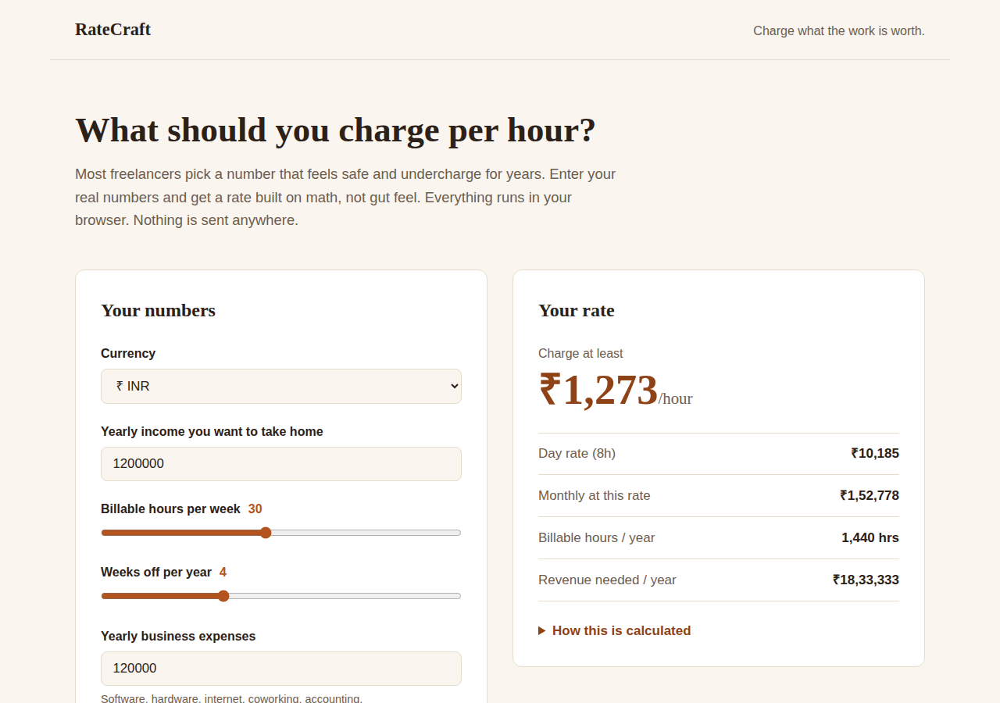

# RateCraft

**Live:** https://ratecraft-calc.vercel.app

What should you charge per hour? Enter your real numbers and get a rate built on math, not gut feel.



## How it works

1. Add your yearly take-home goal and business expenses.
2. Gross it up for tax: divide by (1 − tax rate).
3. Divide by billable hours per year: weekly hours × (52 − weeks off).
4. Gross up once more for the platform fee, so the cut comes out of the client's pocket, not yours.

Supports ₹, $, €, £ with locale-correct formatting. Everything runs in the browser. No data leaves your device.

## Run it

Open `index.html`, or serve the folder:

```bash
npx serve .
```

## Built with Aegis

Designed, audited, and fixed with the [Aegis](https://github.com/adityapratap0077-cloud/aegis) skill pipeline. See `AEGIS-REPORT.md` for the audit.

## License

MIT
